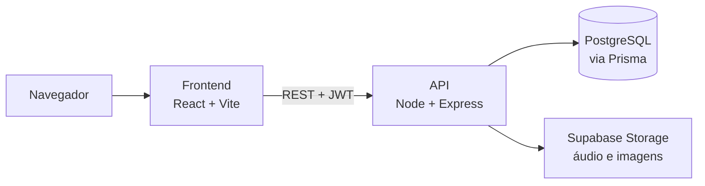

# STATUS - NÃO FINALIZADO
# 🎧 NOIZ

**Streaming de música para quem vive o corre da música.**
Ouvintes montam playlists e curtem faixas; artistas independentes sobem as próprias músicas e ganham uma página pública.


<!-- DEMO: quando publicar na Vercel, coloque o link aqui, por exemplo:
**👉 [Ver o projeto no ar](https://seu-projeto.vercel.app)** -->

<!-- PRINTS: salve as imagens em docs/screenshots/ e troque este comentário por:

Sugestão: Home (tema escuro), player tocando, Estúdio do artista, tema claro. Um GIF de 5–10s do player vale mais que qualquer parágrafo. -->

## Por que fiz

Queria um criar projeto que me desafiasse e sanasse a minha curiosidade sobre como criar uma plataforma de streaming, e que fosse além do CRUD: autenticação de verdade, upload de arquivo, um player que toca áudio de fato, e uma arquitetura que eu conseguisse explicar camada por camada. Streaming de música reúne tudo isso e ainda tem espaço para identidade visual própria — aqui, fundo escuro, alto contraste e um verde-limão neon, bem longe do visual das plataformas grandes.


## O que dá para fazer

**Ouvinte**
- Criar conta, entrar e recuperar a senha por e-mail
- Tocar músicas com player completo: play/pause, próxima/anterior, barra de progresso, volume, aleatório e repetir
- Buscar por música, artista e álbum
- Criar playlists (nome, descrição, capa, pública ou privada), curtir músicas e ver o histórico
- Visitar páginas de artista e de álbum
- Usar no celular (navegação própria) e alternar entre tema escuro e claro

**Artista**
- Virar artista pelo perfil
- Enviar músicas e capas, criar álbuns e gerenciar o próprio catálogo no Estúdio

## Como foi construído



| Camada | Tecnologias |
| --- | --- |
| Frontend | React, TypeScript, Vite, Tailwind CSS, React Router, TanStack Query, Zustand, React Hook Form + Zod |
| Backend | Node.js, Express, TypeScript, Prisma, PostgreSQL, JWT, bcrypt, Multer, Zod |
| Infra | Docker Compose, GitHub Actions, Supabase Storage, Neon, Vercel, Render/Railway |

### Decisões que valem a conversa

- **Backend em camadas** (`route → controller → service → repository`). Só o repository conhece o Prisma, e só o service tem regra de negócio, então dá para testar as regras sem subir servidor nem banco.
- **Login com refresh token rotativo.** O access token dura 15 minutos; o refresh token só vale uma vez e fica salvo como hash no banco. Trocar a senha derruba todas as sessões abertas.
- **Player separado em duas peças.** O estado (fila, faixa, progresso) fica num store Zustand, e um componente invisível controla o `<audio>` de verdade. A barra do player só desenha botões.
- **Autorização por posse.** Só a dona edita a playlist, e só o artista edita as próprias músicas. Playlist privada responde 404 para os outros, sem revelar que ela existe.
- **Renovação de sessão sem corrida.** Se várias requisições expiram juntas, só uma renovação sai e as outras esperam. Sem isso, a rotação do refresh token deslogava o usuário à toa.
- **Tema por variáveis CSS.** Escuro e claro trocam só os valores das cores, e nenhum componente precisa saber em qual tema está.
- **Entrada validada nos dois lados.** As mesmas regras (Zod) no formulário e na API; as variáveis de ambiente também são validadas ao iniciar.

### Qualidade

- 20 testes no backend e 17 no frontend (regras de auth, permissões de playlist e lógica do player)
- ESLint e TypeScript em modo estrito; CI no GitHub Actions rodando lint, tipos, testes e build
- API documentada com OpenAPI (38 operações, em `/docs`)

## Rodando na sua máquina

Precisa de **Docker** e **Node 22+**.

```bash
docker compose up --build
docker compose exec backend npx prisma db seed   # dados de exemplo (em outro terminal)
```

Abra http://localhost:5173 e entre com `ouvinte@noiz.app` / `Senha123`.
Upload de arquivos e envio de e-mail são opcionais e exigem chaves do Supabase e do Resend; o guia completo está em **[docs/DESENVOLVIMENTO.md](docs/DESENVOLVIMENTO.md)** (variáveis de ambiente, scripts, deploy e problemas comuns).

## Estado do projeto e próximos passos

Implementado: autenticação, upload de músicas e capas, player, playlists, curtidas, histórico, busca e Estúdio do artista.
O que ainda falta, e que estou aprendendo:

- [ ] Testes de integração da API (com banco de teste) e testes E2E (Playwright)
- [ ] Reordenar músicas da playlist com drag and drop e mostrar a fila
- [ ] Seguir artistas e receber notificações de lançamento
- [ ] Painel de métricas para artistas

## Autor

**Frederico Docas de Oliveira**, estudante de Análise e Desenvolvimento de Sistemas na UNA (Belo Horizonte) e em busca da primeira oportunidade como desenvolvedor, fiz esse projeto apenas para aprimorar minhas habilidades como desenvolvedor.

[GitHub](https://github.com/Doccas-XVI) ·[Linkedin](https://www.linkedin.com/in/frederico-docas/) 
